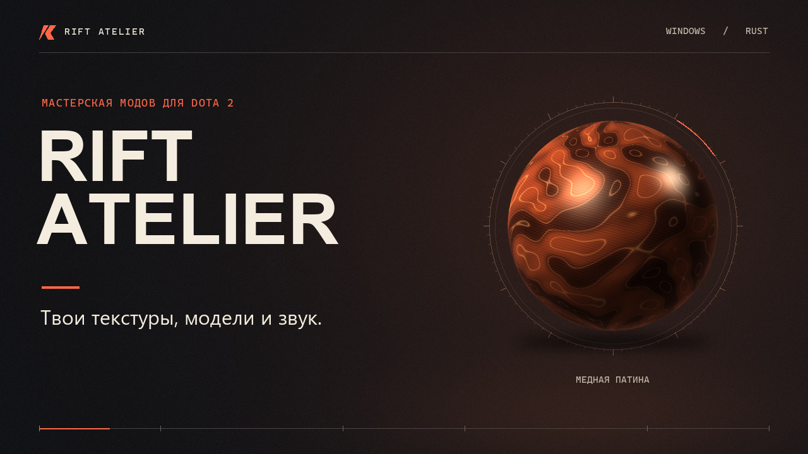

# Rift Atelier

[](https://github.com/TheFPP/rift-atelier/releases/latest/download/RiftAtelier-promo.mp4)

**Менеджер модов Dota 2 для Windows x64, написанный на Rust.** Собирайте свои текстуры, модели и звуки в профили, меняйте порядок замен и применяйте набор одним VPK. После записи пакета приложение можно закрыть.

[Скачать для Windows](https://github.com/TheFPP/rift-atelier/releases/latest/download/RiftAtelier-1.0.0.exe) · [Посмотреть промо](https://github.com/TheFPP/rift-atelier/releases/latest/download/RiftAtelier-promo.mp4) · [Руководство](docs/guide-ru.md) · [Поддержать автора](https://www.donationalerts.com/r/the_fpp)

## Первая замена

1. Запустите EXE. Rift Atelier найдёт игру в библиотеках Steam. При необходимости выберите расположение Dota 2 и язык озвучки в настройках.
2. Перетащите готовый VPK или ZIP в окно, добавьте собственный ресурс или скачайте пакет через встроенный каталог. Для отдельного файла выберите игровой ресурс, который он заменит.
3. В библиотеке выберите моды. Откройте «Профили», если нужно изменить их порядок. Когда несколько модов меняют один путь, приоритет получает нижний в списке.
4. Закройте Dota 2 и нажмите **«Применить в Dota 2»**. Дождитесь сообщения о проверке записанного пакета и запустите игру. Удобнее всего посмотреть результат в деморежиме нужного героя.

## Возможности

- Поиск по нескольким словам, фильтр выбранного и сортировка библиотеки по дате добавления, имени или размеру. **Ctrl+F** переводит курсор в поиск.
- Предпросмотр картинок из архива, собственные обложки, прослушивание исходного WAV.
- Импорт компилированных ресурсов Source 2, изображений PNG/JPEG/TGA, звука PCM WAV и подготовленных проектов VMDL.
- Экспорт профиля в самостоятельный VPK. Установка в игру занимает отдельный свободный слот. В настройках можно снять записанный пакет.
- Галерея шести героев на главной. Для первого просмотра каждого портрета нужен интернет. Повторно он открывается из локального кэша.

Кнопка **БКБ** разворачивает окно и включает золотое оформление на 9 секунд при первом применении, на 8 при втором и на 7 при каждом следующем. Затем окно возвращается к прежнему виду. Перезарядка длится 95 секунд с момента нажатия. Таймер виден на кнопке, а при новом запуске приложения отсчёт применений начинается заново. [Характеристики Black King Bar у Valve](https://www.dota2.com/datafeed/itemdata?item_id=116&language=english)

При активации звучит оригинальный эффект из установленной Dota 2. Эффект приглушён на 18 дБ. Если игровой звук недоступен, кнопка работает без звука.

Рядом с БКБ можно поддержать автора через DonationAlerts.

## Совместимость

Прямая установка рассчитана на Windows x64 и установленную в Steam русскую, корейскую или упрощённую китайскую озвучку. Выбранная озвучка должна совпадать с настройкой игры. Для других языков доступен экспорт VPK. Встроенному веб-каталогу нужен Microsoft Edge WebView2 Runtime, а компиляции исходных VMDL — Dota 2 Workshop Tools. Моды, библиотека и профили хранятся локально.

## Сборка

Понадобятся Rust stable с Windows MSVC и Visual Studio C++ Build Tools с Windows SDK. В корне репозитория выполните команды.

```powershell
cargo test --locked
cargo build --release --locked
```

Готовое приложение появится в `target\release\rift-atelier.exe`.

## Лицензия

Исходный код Rift Atelier распространяется по [лицензии MIT](LICENSE). Dota 2 и изображения героев принадлежат Valve. Изображения галереи загружаются с CDN Valve при просмотре. Права на моды из сторонних каталогов принадлежат их авторам.
